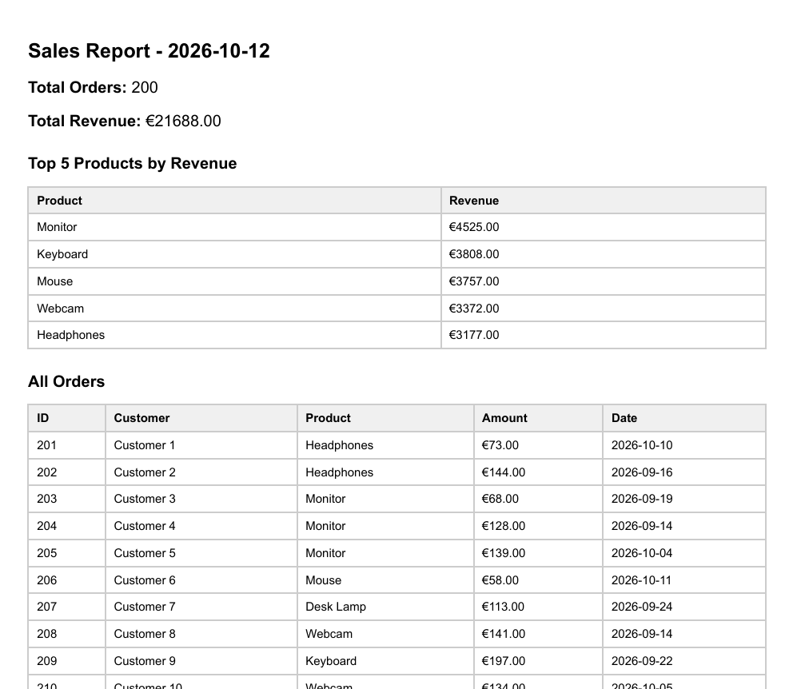

# PDF Report Generator

A small backend pipeline that turns SQL data into a real PDF report and serves it by link. Built as FlyRank Internship Assignment A8 (Backend AI Engineering track, Week 7).

## Dataset

**Option A - the little shop.** A SQLite database (`report.db`) with one `orders` table (`id`, `customer`, `product`, `amount`, `created_at`), seeded with 200 randomly generated orders across 6 products and the last 30 days.

## How it works

1. **Query** - one function (`getReportData()`) aggregates the raw rows into: total orders, total revenue, top 5 products by revenue, and orders per day for the last 7 days.
2. **Render** - the aggregated data is dropped into an HTML template and rendered to PDF with Playwright (headless Chromium), with print CSS (`break-inside: avoid`, repeating `<thead>`) so no table row is split across a page break.
3. **Store** - the PDF is saved to `reports/<id>.pdf` on disk; only its path is stored in the database.
4. **Serve** - the client requests a report by API call and downloads the finished file by link. JSON responses never carry the file's bytes, only the download endpoint does.

## Aggregation SQL

```sql
-- Total orders
SELECT COUNT(*) as count FROM orders;

-- Total revenue
SELECT SUM(amount) as total FROM orders;

-- Top 5 products by revenue
SELECT product, SUM(amount) as revenue
FROM orders
GROUP BY product
ORDER BY revenue DESC
LIMIT 5;

-- Orders per day, last 7 days
SELECT created_at as date, COUNT(*) as count
FROM orders
WHERE created_at >= date('now', '-7 days')
GROUP BY created_at
ORDER BY created_at ASC;
```

## API

- `POST /reports` - generates a new report (or returns today's existing one, see Idempotency below). Returns `201` (new) or `200` (existing) with `{ id, file }`.
- `GET /reports/:id` - returns the report's metadata. `404` if the id doesn't exist.
- `GET /reports/:id/file` - downloads the PDF from disk.

### Proof

```bash
$ curl -i -X POST http://localhost:3000/reports
HTTP/1.1 201 Created
{"id":1,"file":"/reports/1/file"}

$ curl -o my-report.pdf http://localhost:3000/reports/1/file
# downloads a real, valid PDF (opens correctly, 7+ pages, no split rows)
```

## Idempotency

`POST /reports` checks whether a report was already generated today before creating a new one. If one exists, it returns the same `id` and link with `200` instead of generating a duplicate. Pass `{ "force": true }` in the request body to force a fresh one anyway.

**What this protects against:** a user double-clicking "Generate report" (or a retried request) would otherwise create a new file and a new row every time, wasting disk space and render time for no reason. The same principle is why, in the paired workshop, a report pipeline never emails a customer the same invoice twice - an accidental retry should never double-charge or double-notify someone.

### Proof

```bash
$ curl -i -X POST http://localhost:3000/reports
HTTP/1.1 200 OK
{"id":1,"file":"/reports/1/file"}

$ curl -i -X POST http://localhost:3000/reports
HTTP/1.1 200 OK
{"id":1,"file":"/reports/1/file"}
# same id both times, only one file in reports/

$ curl -i -X POST -d '{"force":true}' -H "Content-Type: application/json" http://localhost:3000/reports
HTTP/1.1 201 Created
{"id":2,"file":"/reports/2/file"}
# force:true creates a new one regardless
```

## When would this move to a background job?

Right now the whole pipeline (query, render, store) runs inside the `POST /reports` request, and the response visibly pauses for a couple of seconds while Playwright renders the PDF. That's acceptable for one user clicking one button. It would stop being acceptable once report generation gets slow enough, or frequent enough, that it starts blocking or timing out requests, for example once the `orders` table grows into the tens of thousands of rows, or many users request reports around the same time. At that point, `POST /reports` should enqueue the work (an Inngest function running query, render, and save as separate steps) and return `202 Accepted` immediately, with `GET /reports/:id` reporting a `pending` / `done` status instead of making the client wait on an open connection.

## Getting started

```bash
# 1. Install dependencies
npm install
npx playwright install chromium

# 2. Seed the database (safe to run more than once, clears and re-inserts)
node seed.js

# 3. Start the server
node server.js

# 4. In another terminal, generate a report
curl -i -X POST http://localhost:3000/reports
curl -o my-report.pdf http://localhost:3000/reports/1/file
```

## Tech stack

- Node.js + Express
- SQLite (`node:sqlite`, built-in)
- Playwright (headless Chromium, HTML to PDF)

## Example output


